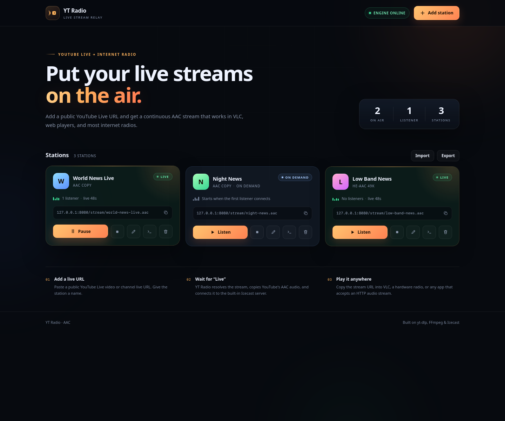
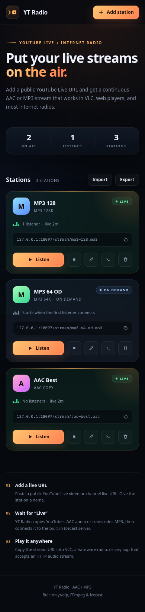

# YT Radio

[](https://github.com/clove3am/yt-to-radio-stream/actions/workflows/release.yml)

Turn public **YouTube Live** streams into continuous **AAC or MP3 internet radio** streams, managed from a small web dashboard.

Each station runs its own pipeline:

```text
YouTube Live ──▶ yt-dlp ──▶ FFmpeg (AAC copy / MP3) ──▶ Icecast
                                                               │
Browser dashboard  ◀── FastAPI control UI / API                 │
Stream players     ◀── GET /stream/<station>.aac|mp3  ◀──────────┘
```

The app, Icecast, FFmpeg and yt-dlp all live in one Docker container. The only exposed port is the web UI, which also proxies the radio streams, so a single port works behind a reverse proxy or over HTTPS.

| Desktop | Mobile |
| --- | --- |
|  |  |

## Features

- Multiple simultaneous stations, each with a stable stream URL
- Per-station **Always on** or **On demand** mode; on-demand stations only run while listeners are connected
- Full dashboard: add, edit, start, stop, restart and delete stations
- Live status, unique-listener and connection counts, uptime and retry countdown
- Automatic reconnects with exponential backoff when a stream ends or the network drops
- Persistent station list — always-on stations resume after a container restart; on-demand stations return to standby
- **AAC passthrough** at source quality with no audio transcode
- **HE-AAC passthrough** at ~49 kbps for low bandwidth, always-on only
- **MP3 128k / 64k** transcoding for players that require MP3
- Synthesized hold music while on-demand stations tune in (or silence via `TUNING_AUDIO`)
- Import/export all station definitions as JSON
- Scheduled GHCR rebuilds when a new yt-dlp release appears on PyPI
- Dependabot updates for GitHub Actions, Python packages and Docker base images
- Bundled Deno + yt-dlp EJS solver for modern YouTube JavaScript challenges
- ICY headers (`icy-name`, `icy-genre`) for radio-player compatibility
- Optional HTTP Basic auth for the dashboard/API
- Optional cookies file for age-restricted or bot-checked YouTube streams
- Dark, responsive UI with in-browser preview playback

## Quick start

Requirements: Docker with Compose v2.

```bash
cp .env.example .env
# Edit .env and set a strong APP_PASSWORD
docker compose up -d --build
```

Open <http://localhost:8080>, click **Add station**, paste a public YouTube Live URL, and choose an audio format and streaming mode. An **Always on** station starts immediately and waits for **Live** (usually 5–20 seconds). An **On demand** station stays on standby until its first listener connects (keep **Enable for listeners** checked).

Copy the station's stream URL into any player that accepts an HTTP audio stream. For VLC: **Media → Open Network Stream** and enter:

```text
http://your-host:8080/stream/<station-slug>.aac
```

MP3 stations use the same URL with `.mp3` instead.

To stop:

```bash
docker compose down
```

Data is kept in the `radio-data` volume, so `docker compose up -d` brings your stations back. To back up the station database safely (SQLite uses a WAL), stop the container first:

```bash
docker compose stop radio
docker compose cp radio:/data/app.db ./app.db.backup
docker compose start radio
```

Restore it with `docker compose cp ./app.db.backup radio:/data/app.db` while the container is stopped.

### Import / export stations

Use **Import** and **Export** beside the Stations heading. Export downloads a JSON file containing all station definitions; Import reads that file in the browser with two modes:

- **Merge** (default): adds the imported stations. Slugs are preserved unless they collide, in which case a numeric suffix is added.
- **Replace all**: stops and deletes every existing station before importing the file.

The export contains names, YouTube URLs, slugs, codecs, always-on/on-demand mode and enabled state. It does **not** include cookies, the dashboard password or other container settings.

API equivalents: `GET /api/export` and `POST /api/import` with `{"stations": [...], "replace": false}`.

## Configuration

Copy `.env.example` to `.env`; Compose reads it automatically.

| Variable | Default | Purpose |
| --- | --- | --- |
| `APP_PORT` | `8080` | Host port for the UI and streams |
| `APP_USERNAME` | `admin` | Dashboard/API username (when a password is set) |
| `APP_PASSWORD` | empty | Enables HTTP Basic auth when non-empty |
| `ON_DEMAND_IDLE_SECONDS` | `30` | Grace period before an on-demand stream stops after its last listener |
| `ON_DEMAND_START_TIMEOUT` | `75` | Max seconds a listener waits for an on-demand stream to tune in |
| `TUNING_AUDIO` | `music` | On-demand tuning audio: `music` or `silence` |
| `YTDLP_COOKIES_FILE` | `/data/cookies.txt` | Optional Netscape-format cookies file |
| `YTDLP_EXTRA_ARGS` | empty | Extra yt-dlp arguments (shell-quoted) |
| `LOG_LEVEL` | `info` | `debug`, `info` or `warning` |
| `TZ` | `UTC` | Container timezone for log timestamps |

Advanced container-level variables: `ICECAST_PORT` (default `8000`, internal only), `ICECAST_HOST` (default `127.0.0.1`), `ICECAST_MANAGED` (default `true`), `ICECAST_BINARY`, `FFMPEG_BINARY`, `YTDLP_BINARY`, `ICECAST_WEBROOT`, `ICECAST_ADMINROOT`.

To use an Icecast server you run yourself, set `ICECAST_MANAGED=false`, point `ICECAST_HOST`/`ICECAST_PORT` at it, and set `ICECAST_SOURCE_PASSWORD` to that server's source password. The app will not spawn its bundled Icecast.

### Audio formats

AAC copy is the default and avoids audio conversion. MP3 is available for players and apps that require an MP3 stream.

- **AAC copy (best)** — AAC-LC, roughly 130 kbps for most YouTube live streams. Always-on or on-demand.
- **HE-AAC copy (49 kbps)** — YouTube's low-bandwidth HE-AAC track. Always-on only, because its profile cannot be safely spliced into the AAC-LC tuning placeholder used by on-demand mode.
- **MP3 128k** — transcoded MP3 at 128 kbps. Always-on or on-demand. This is the MP3 match for AAC copy's bandwidth.
- **MP3 64k** — transcoded MP3 at 64 kbps. Always-on or on-demand. This is the low-bandwidth MP3 option.

Higher MP3 bitrates are intentionally not offered: the reference AAC stream is around 130 kbps, so 160–320 kbps MP3 would only add bandwidth.

AAC streams use `.aac` URLs; MP3 streams use `.mp3`. The extension must match the station's current format; there are no compatibility redirects. Changing a station's codec changes its URL, so update saved presets.

Existing codec values are migrated to the nearest supported format on startup. Old MP3 rows remain MP3 128k; old always-on AAC-64k stations become HE-AAC; on-demand AAC-64k stations become AAC copy; unsupported values become AAC copy.

### Always on vs on demand

**Always on** is the default. The YouTube/FFmpeg pipeline runs continuously, even with zero listeners, so every player gets instant audio and the station works as a 24/7 broadcast.

**On demand** only runs while listeners are connected:

- The station is armed but idle; no yt-dlp or FFmpeg process runs and no YouTube bandwidth is used.
- The first listener starts the pipeline. While it tunes in, YT Radio streams a short synthesized hold-music loop in the station's codec so players stay connected instead of timing out.
- The first listener hears the hold music for 5–20 seconds before live audio begins. Set `TUNING_AUDIO=silence` to use silence instead.
- When the last listener leaves, the pipeline stops after `ON_DEMAND_IDLE_SECONDS` (default 30). Set it to `0` to stop immediately.
- The stream URL stays the same, and the station returns to standby after stopping.

Stream URLs are public, so anyone who knows an on-demand URL can wake the station. Use a firewall or reverse-proxy rules if that is not acceptable.

HE-AAC copy stations are always-on only. Selecting HE-AAC in the dashboard forces the station back to **Always on**.

Changing a station's mode or settings while it is live restarts it. On-demand stations go back to standby and start again when the next listener connects.

### Auth and stream access

If `APP_PASSWORD` is set, the dashboard and JSON API require HTTP Basic auth. **Stream URLs stay public** because most radio players cannot negotiate a login prompt. If you need private streams, restrict access at your reverse proxy or firewall.

Basic auth sends credentials in a reversible encoding, so terminate HTTPS at a reverse proxy whenever the dashboard is reachable over the internet.

### Cookies for age-restricted or bot-checked streams

Export YouTube cookies in Netscape format using a browser extension, then place them in the container's data volume:

```bash
docker compose cp cookies.txt radio:/data/cookies.txt
docker compose exec -u root radio chown radio:radio /data/cookies.txt
```

`YTDLP_COOKIES_FILE` defaults to `/data/cookies.txt`. The next stream attempt picks the file up; restart the station from the dashboard if it is already running.

If you prefer a bind mount, replace the volume in `docker-compose.yml`:

```yaml
volumes:
  - ./data:/data
```

Then make the host directory writable by the container user (UID 1000):

```bash
mkdir -p data
sudo chown -R 1000:1000 data
```

### Reverse proxy / HTTPS

The app supports `X-Forwarded-*` headers. Disable proxy buffering for stream routes and allow long-lived connections.

**Caddy**

```caddyfile
radio.example.com {
    reverse_proxy 127.0.0.1:8080 {
        flush_interval -1
    }
}
```

For stream reliability, do not apply `response_buffers`/`buffer_responses` to `/stream/*`, and exclude stream paths from `encode` if compression is enabled. YT Radio also sends `Incremental: ?1`, which Caddy 2.11+ uses to forward stream bodies immediately:

```caddyfile
radio.example.com {
    encode {
        match {
            not path /stream/*
        }
        zstd gzip
    }

    handle /stream/* {
        reverse_proxy 127.0.0.1:8080 {
            flush_interval -1
        }
    }

    handle {
        reverse_proxy 127.0.0.1:8080
    }
}
```

**nginx**

```nginx
location / {
    proxy_pass http://127.0.0.1:8080;
    proxy_http_version 1.1;
    proxy_set_header Host $host;
    proxy_set_header X-Forwarded-For $proxy_add_x_forwarded_for;
    proxy_set_header X-Forwarded-Proto $scheme;
    proxy_buffering off;
    proxy_read_timeout 3600s;
}
```

The dashboard builds stream URLs from the browser's current origin, so the URLs automatically use your HTTPS domain.

## Automated container releases

`.github/workflows/release.yml` builds and publishes the image to GitHub Container Registry whenever a version tag is pushed.

```bash
git tag -a v1.0.0 -m "v1.0.0"
git push origin v1.0.0
```

The tag must look like `v1.2.3` (an optional prerelease suffix such as `v1.2.3-rc1` is allowed). The workflow publishes multi-architecture images for `linux/amd64` and `linux/arm64`:

- `ghcr.io/clove3am/yt-to-radio-stream:1.2.3`
- `ghcr.io/clove3am/yt-to-radio-stream:1.2`
- `ghcr.io/clove3am/yt-to-radio-stream:1`
- `ghcr.io/clove3am/yt-to-radio-stream:latest` for stable tags
- `ghcr.io/clove3am/yt-to-radio-stream:yt-dlp-2026.10.26` for automatic yt-dlp rebuilds

Prerelease tags do not update `major`, `major.minor` or `latest`.

### Automatic yt-dlp updates

The same workflow checks PyPI for a new `yt-dlp` release every six hours. If the matching `yt-dlp-<version>` tag does not exist in GHCR, it builds the current `main` branch with that exact yt-dlp version and publishes both `latest` and the `yt-dlp-<version>` tag.

This means `latest` is a rolling image that can be newer than the last semver release tag. Use a semver tag for a frozen application release, or `yt-dlp-<version>` to pin the yt-dlp build.

Version-tag releases also refresh `latest` and the corresponding `yt-dlp-<version>` tag using the exact current yt-dlp release, so the yt-dlp tag always tracks the newest app build for that yt-dlp version.

Run the check manually with:

```bash
gh workflow run release.yml --repo clove3am/yt-to-radio-stream
```

To update a deployment:

```bash
docker compose pull radio
docker compose up -d --no-build
```

Only use `--no-build` when `RADIO_IMAGE` is set to the GHCR image.

### Dependabot

`.github/dependabot.yml` checks weekly for updates to:

- GitHub Actions workflow dependencies
- Python packages in `requirements.txt`
- Docker base images (`python` and Deno)

`yt-dlp` itself is ignored by Dependabot because the scheduled GHCR workflow handles it. Dependabot only opens pull requests; an image is not published until the change is merged and a tag is pushed, or until the next scheduled yt-dlp rebuild picks up `main`.

To run the published image instead of building locally:

```bash
docker pull ghcr.io/clove3am/yt-to-radio-stream:latest
RADIO_IMAGE=ghcr.io/clove3am/yt-to-radio-stream:latest docker compose up -d --no-build
```

Add `RADIO_IMAGE=...` to `.env` to make that persistent. Package visibility is controlled in GitHub package settings. If the package is private, log in first with a PAT that has `read:packages`:

```bash
echo "$GHCR_TOKEN" | docker login ghcr.io -u <github-username> --password-stdin
```

## Updating yt-dlp

GHCR deployments update automatically when PyPI publishes a new yt-dlp version. For a local build, rebuild the image to pin a fresh copy:

```bash
docker compose build --pull --no-cache
docker compose up -d
```

For a quick temporary update inside a running container (the app runs as an unprivileged user, so install as root):

```bash
docker compose exec -u root radio pip install -U yt-dlp yt-dlp-ejs
```

New stream attempts use the updated binary. The change is lost when the container is recreated.

## Troubleshooting

Check logs with:

```bash
docker compose logs -f radio
```

| Symptom | Likely cause / fix |
| --- | --- |
| Station stays on **Tuning** | Open **Logs** on the card. yt-dlp may be waiting on a stream that is offline, private, or region-locked. |
| On-demand station stays on **On demand** | Expected with zero listeners. Play the stream URL or click **Listen** to start it. |
| First on-demand listener hears hold music | The station is tuning. Live audio begins once yt-dlp/FFmpeg connects, usually within 5–20 seconds. Set `TUNING_AUDIO=silence` if you prefer silence. |
| `Sign in to confirm you're not a bot` | Add a cookies file (see above). |
| `This live stream recording is not available` | The URL is not currently live or is unavailable in the container's region. |
| **Retrying** with `Connection refused` | Icecast is restarting. The engine chip at the top shows its state; stations reconnect automatically. |
| Engine offline | Run `docker compose logs radio`; verify internal port 8000 is not occupied by another process in the container network. |
| No audio in VLC but the card says Live | Test with `ffplay http://host:8080/stream/<slug>.aac`, check firewall rules, and confirm the URL uses the correct host/port. |
| AAC stream will not play | Select **MP3 128k** or **MP3 64k** for players/apps that require MP3. |
| AAC station retries with `Requested format is not available` | The source has no usable AAC track; select an MP3 format. |
| HE-AAC cannot be selected with On demand | By design. HE-AAC copy is always-on only. |
| Listener count differs from Icecast | The dashboard counts unique client IPs; Icecast counts connections. Use the connection count shown beside it to spot duplicate client sessions. |
| Proxy returns headers but no audio / stream ends after a few seconds | The reverse proxy is buffering or compressing the stream. Apply `flush_interval -1` to `/stream/*`, remove response buffering, and exclude streams from `encode`. |
| MP3-only app gets no audio | Change the station format to **MP3 128k** or **MP3 64k** and update the saved URL from `.aac` to `.mp3`. |
| Container exits with a data permission error | A bind-mounted `./data` is not writable by UID 1000. Run `sudo chown -R 1000:1000 data`. |

## API

All mutating requests from the UI include `X-Requested-With: yt-radio`. When `APP_PASSWORD` is set, that header is required on API writes (CSRF protection), in addition to Basic auth.

| Method | Path | Purpose |
| --- | --- | --- |
| `GET` | `/api/stations` | List stations with live status |
| `GET` | `/api/stations/{id}` | Get one station |
| `POST` | `/api/stations` | Create `{name, url, codec, on_demand, autostart}` |
| `PATCH` | `/api/stations/{id}` | Update `{name?, url?, codec?, on_demand?}` (restarts if live) |
| `DELETE` | `/api/stations/{id}` | Stop and delete a station |
| `POST` | `/api/stations/{id}/start` | Start an always-on station, or arm an on-demand station |
| `POST` | `/api/stations/{id}/stop` | Stop / disable a station |
| `POST` | `/api/stations/{id}/restart` | Restart an always-on pipeline; re-arm an on-demand station |
| `GET` | `/api/stations/{id}/logs` | Recent yt-dlp/FFmpeg output |
| `GET` | `/stream/{slug}.aac` | Public AAC stream |
| `GET` | `/api/export` | Export all station definitions |
| `POST` | `/api/import` | Import `{stations, replace}` |
| `GET` | `/healthz` | Engine health (public) |

`codec` is `aac` (AAC-LC copy), `aac_he` (HE-AAC copy, ~49 kbps), `mp3` (128 kbps) or `mp3_low` (64 kbps). `aac_he` requires `on_demand: false`; the other formats support both modes.

Example:

```bash
curl -X POST http://localhost:8080/api/stations \
  -H 'Content-Type: application/json' \
  -H 'X-Requested-With: yt-radio' \
  -d '{"name":"My Live Station","url":"https://www.youtube.com/watch?v=VIDEO_ID","codec":"aac","on_demand":false,"autostart":true}'
```

## How it works

1. The FastAPI manager spawns one `yt-dlp` process per station (with Deno/EJS available for YouTube's JavaScript challenges), piping the best available audio into FFmpeg.
2. FFmpeg copies the selected AAC profile or transcodes MP3, then pushes it to an internal Icecast mount at `/stream/<slug>.aac` or `.mp3`.
3. The browser UI fetches Icecast's status JSON for source/listener state.
4. Public listeners hit FastAPI's stream route, which proxies Icecast with ICY headers and disabled buffering.
5. For on-demand stations, each stream request holds a listener lease. The first lease starts the pipeline; the last lease release schedules an idle stop.

Station status is one of `live`, `starting`, `standby` (on-demand, no active listeners), `retrying`, or `stopped` (disabled). The dashboard polls every 4 seconds; listener counts can lag by a few seconds.

## Notes and limits

- Only public YouTube Live streams (and upcoming premieres) are supported. Private, members-only, and DRM-protected content will not work, even with cookies, in many cases.
- This project does not bypass YouTube restrictions. Only stream content you have the rights to rebroadcast, and respect YouTube's terms of service.
- Radio latency is typically 10–30 seconds due to live-edge buffering and AAC/MP3 processing. This is not a low-latency monitor feed.
- On-demand stations add 5–20 seconds of tuning at the start of the first listener's session; subsequent listeners join the running stream instantly.
- AAC copy stations use roughly the YouTube source's audio bitrate; MP3 stations use 128 or 64 kbps. Bandwidth scales with every listener.
- Listener counts are unique client IPs seen by the proxy. The card also shows raw connections when a client has opened more than one. Devices behind the same NAT/IP count as one listener; a reverse proxy must forward `X-Forwarded-For` for accurate counts.
- A station's URL slug is generated from its name when it is created and stays stable when you rename it, so existing radio presets keep working.
- Icecast is configured for up to 64 stations and 500 concurrent listeners. The app is designed to run as a **single** Uvicorn worker; do not scale replicas against the same data volume.
- The stream proxy uses HTTP/1.1 chunked transfer encoding. VLC, FFmpeg, browsers and modern radio players handle this; a very old hardware player that requires HTTP/1.0 framing may not.

## Local development

You need Python 3.12+, FFmpeg, Icecast 2.4+ and yt-dlp on the host. On Debian/Ubuntu:

```bash
sudo apt install ffmpeg icecast2
sudo systemctl stop icecast2   # the app starts its own instance on port 8000
python3 -m venv .venv
source .venv/bin/activate
pip install -r requirements.txt

DATA_DIR=./data APP_PASSWORD= uvicorn app.main:app --reload
```

For the most reliable YouTube extraction, also install [Deno](https://deno.com/) 2.3+ and make sure `deno` is on your `PATH`; the Docker image bundles it.

Icecast is started automatically on `127.0.0.1:8000`; the UI is on <http://localhost:8080>. To use the packaged Icecast service instead, set `ICECAST_MANAGED=false` and `ICECAST_SOURCE_PASSWORD` to match its configuration.

## Project layout

```text
app/
  main.py       FastAPI routes, auth, stream proxy
  manager.py    per-station process supervision, demand leases and retry logic
  audio.py      synthesized hold-music generation for on-demand listeners
  icecast.py    Icecast config generation, process lifecycle, stats
  db.py         SQLite persistence
  models.py     station models and request validation
  config.py     environment configuration
  static/       dashboard HTML/CSS/JS and favicon
Dockerfile
docker-compose.yml
entrypoint.sh
.github/workflows/release.yml
.github/dependabot.yml
```
